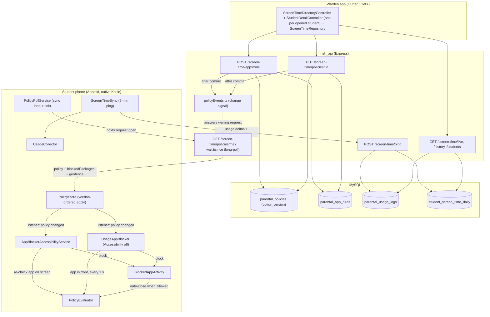

# Parental Control & Screen Time

> **Last updated:** 2026-11-21 · **Repos:** `hsh_app2` (Flutter + native Android) and `hsh_api` (Node/Express/MySQL)
>
> Paths starting with `lib/` or `android/` are in this repo; paths starting with `hsh_api/` are in the backend repo. Location tracking and curfew breaches are documented separately in [GEOFENCING_DOCS.md](GEOFENCING_DOCS.md).

---

## 1. What this feature does

Wardens (the operator console / platform admins) control and monitor each student's Android phone:

| Rule / feature | Behaviour on the student's phone |
| :--- | :--- |
| **Remote lock** | Every app except calls, keyboards, the launcher, Settings and this app is blocked until the warden unlocks. |
| **Blocked apps** | Individual apps (e.g. Instagram) are blocked. Takes effect immediately, **even if the app is already open**. |
| **App time limit** | Individual apps are blocked once today's usage reaches the app's configured limit. 0 = no limit. |
| **Bedtime** | Apps are blocked inside a nightly window (e.g. 23:00–05:00). Off when no bedtime is set. |
| **Daily limit** | Apps are blocked once today's total screen time reaches the limit. 0 = no limit. |
| **Usage dashboard** | Today's total, per-app breakdown, 30-day history, online / screen-on / current app. |

All rules are enforced **on the phone**, so they keep working offline and with the app closed. They are enforced by the Accessibility service, or, while it is off, from usage events (5.6), because some UPI and bank apps refuse to work while a third-party accessibility service is on. Policy changes reach the phone **within about a second while its screen is on** (see section 4).

The curfew geofence **does not lock phones**; remote lock is the only lock wardens have.

---

## 2. Architecture

**Warden app structure (Screen Time):** `ScreenTimeRepository` makes every `/screen-time/*` call. `ScreenTimeDirectoryController` owns the student list (paging, search, summary counts), the hostel-wide night curfew and the pending app requests. Opening a student creates a `StudentDetailController` for that student only, registered under the student's id as its Get tag and deleted when the details are closed, so no state carries over to the next student. The details widgets receive that controller from the page; shared read-only helpers are top-level functions in `screen_time_utils.dart`. **Screens:** the student list; one student's *overview* (`StudentOverviewBody`: live status, today against the allowance, controls, top apps, pending requests, and links to the sections below); and a screen per section, each opened from the overview and closed with Back: *Usage & trends* (`StudentUsageScreen`: a 7 / 14 / 30 day range; the selected day against the period average with a limit ring; a stacked daily bar chart (daytime, night, over-limit, dashed limit line; tap a bar to pick the day); plain-language insights; a donut of time by app category; weekday averages with a day/night split; top apps. The numbers come from `UsageAnalytics`; resets to today when closed), *Apps* (`StudentAppsScreen`: time per app, block / limit), *Requests & history* (`StudentHistoryScreen`: pending app requests and a month calendar; each date shows that day's total, tinted by how heavy it was and red over the daily limit, and tapping one shows the day's total, night time and top apps; resets to today when closed), *Daily limit & bedtime* (`CurfewLimitScreen`) and *Restrict apps* (`RestrictAppsScreen`). A single app's time limit is still a small bottom sheet (`AppLimitSheet`). The sub-screens share `ScreenTimePage` and the navy `ScreenTimeSubHeader`.



---

## 3. File map

### Flutter (`lib/`)

| File | Role |
| :--- | :--- |
| [screen_time_policy.dart](../lib/features/screentime/models/screen_time_policy.dart) | Policy model (`isLocked`, `blockedPackages`, `dailyLimitMinutes`, `bedtimeStart`, `bedtimeEnd`, `version`). `tryParse()` accepts snake_case and camelCase; an explicit `null` bedtime means "off"; `23:00:00` is shown as `23:00`. |
| [screen_time_service.dart](../lib/core/services/screen_time_service.dart) | `hsh/screen_time` MethodChannel: permissions (incl. "Display over other apps"; `appBlockerReady`), start/stop monitoring, `syncNow`, `refreshPolicy`, `getPolicy`, `getCompliance`. |
| [screen_time_directory_controller.dart](../lib/features/screentime/controllers/screen_time_directory_controller.dart) | Warden dashboard: student directory (paging, search, counts), hostel night curfew, pending app requests. |
| [student_detail_controller.dart](../lib/features/screentime/controllers/student_detail_controller.dart) | One opened student: live status, usage, history, policy and app-rule actions. |
| [student_screen_time_screen.dart](../lib/features/screentime/views/student_screen_time_screen.dart) | Warden dashboard UI. Route `Routes.studentScreenTime`. |
| [parental_controls_card.dart](../lib/features/screentime/widgets/parental_controls_card.dart) | Lock/unlock plus one tile into each settings screen (bedtime & daily limit; blocked apps); shows "Off" when neither is set. |
| [restrict_apps_screen.dart](../lib/features/screentime/views/restrict_apps_screen.dart), [curfew_limit_screen.dart](../lib/features/screentime/views/curfew_limit_screen.dart) | Block an app; set bedtime and daily limit (each its own screen). |
| [device_setup_screen.dart](../lib/features/screentime/views/device_setup_screen.dart) | Student onboarding: Usage access, App blocker ("Display over other apps", or Accessibility via "Use Accessibility instead"), Location "all the time", Battery exemption. |
| [home_controller.dart](../lib/features/home/controllers/home_controller.dart) | On student login/resume: sends the student to setup if a required permission is missing, then calls `syncNow()` and `refreshPolicy()`. |
| [session_store.dart](../lib/core/storage/session_store.dart) | Starts monitoring for student/leader sessions; stops it on logout. |

### Native Android (`android/app/src/main/kotlin/com/example/hsh_app2/screentime/`)

| File | Role |
| :--- | :--- |
| [PolicyPollService.kt](../android/app/src/main/kotlin/com/example/hsh_app2/screentime/PolicyPollService.kt) | Foreground service. **Sync loop:** long-polls the policy (section 4). **Tick** (30 s screen on / 60 s off): geofence work and a re-check of the app on screen for time-based rules. |
| [ScreenTimeSync.kt](../android/app/src/main/kotlin/com/example/hsh_app2/screentime/ScreenTimeSync.kt) | Usage delta ping every 5 minutes (WorkManager tick + 15-min watchdog); `fetchAndSavePolicy()`, the single native policy fetch. |
| [PolicyStore.kt](../android/app/src/main/kotlin/com/example/hsh_app2/screentime/PolicyStore.kt) | Encrypted storage of the session token, policy and backend `policy_version`. `applyPolicyJson()` discards responses older than the applied version and notifies listeners on change. |
| [AppBlockerAccessibilityService.kt](../android/app/src/main/kotlin/com/example/hsh_app2/screentime/AppBlockerAccessibilityService.kt) | Blocks apps when they are opened **and** re-checks the app already on screen whenever the policy changes. |
| [UsageAppBlocker.kt](../android/app/src/main/kotlin/com/example/hsh_app2/screentime/UsageAppBlocker.kt) | Blocker used while the Accessibility service is not connected: reads the app in front from usage events every second (screen on) and opens the block screen (5.6). Runs inside `PolicyPollService`. |
| [ForegroundTracking.kt](../android/app/src/main/kotlin/com/example/hsh_app2/screentime/ForegroundTracking.kt) | Pure helpers for it: `ForegroundReplay` (app in front from usage events) and `BlockScreenThrottle` (show and log once per visit, retry every 2 s). |
| [PolicyEvaluator.kt](../android/app/src/main/kotlin/com/example/hsh_app2/screentime/PolicyEvaluator.kt) | The rule engine (`BlockReason`: device locked, app blocked, bedtime, daily limit) and the always-allowed packages. |
| [BlockedAppActivity.kt](../android/app/src/main/kotlin/com/example/hsh_app2/screentime/BlockedAppActivity.kt) | Full-screen block screen; closes itself as soon as the app is allowed again. |
| [UsageCollector.kt](../android/app/src/main/kotlin/com/example/hsh_app2/screentime/UsageCollector.kt) | Per-app foreground time from usage events; current foreground package. |
| [ScreenTimeWorker.kt](../android/app/src/main/kotlin/com/example/hsh_app2/screentime/ScreenTimeWorker.kt) | WorkManager job: runs the ping and restarts `PolicyPollService` if the OS killed it. |
| [KeepAliveReceiver.kt](../android/app/src/main/kotlin/com/example/hsh_app2/screentime/KeepAliveReceiver.kt) | Alarm that restarts `PolicyPollService` about 5–10 s after the process is killed by Stop in the Active apps panel (screen on), or about 75 s after a kill with the screen off. The service keeps pushing it back (5.5). |
| [KeepAliveActivity.kt](../android/app/src/main/kotlin/com/example/hsh_app2/screentime/KeepAliveActivity.kt) | Invisible screen that starts `PolicyPollService` from the foreground when a background start is refused, then closes (5.5). |
| [BootPolicyReceiver.kt](../android/app/src/main/kotlin/com/example/hsh_app2/screentime/BootPolicyReceiver.kt) | Restarts sync and the poll service after reboot or app update. |

### Backend (`hsh_api/src/`)

| File | Role |
| :--- | :--- |
| `modules/screentime/screentime.routes.ts` | All `/screen-time/*` endpoints, access rules, long-poll, transactional writes. |
| `services/policyEvents.ts` | In-process signal: `notifyPolicyChanged(studentId)` after a commit answers that student's waiting long-poll. |
| `modules/geofence/geofence.service.ts` | `findStudentId()` (numeric `students.id` **only**; bank codes / `student_code` are never matched) and the geofence payload included in `/policies/me`. |
| `config/db.ts` | Startup migrations for the parental tables. |

---

## 4. How a policy change reaches the phone

1. **Warden action.**
   - Blocking/unblocking one app → `POST /screen-time/apps/rule`.
   - Lock/unlock → `PUT /policies/:id` with `{is_locked}` only.
   - Play Store block/allow → `PUT` with `{restrict_app_installs}` only (blocking during an install pass also sends `install_pass_until: 0`).
   - 15-min install pass / revoke → `PUT` with `{install_pass_until}` only (epoch ms, `0` = none).
   - Bedtime and limit → `PUT` with just those fields.
2. **Backend commit.** `policy_version` is bumped in the **same transaction** as the change (the bump comes first and row-locks the policy, so concurrent edits get strictly ordered versions). After the commit `notifyPolicyChanged(studentId)` fires.
3. **Delivery.** With the screen on, the phone keeps `GET /screen-time/policies/me?wait=25&since=<version>` open:
   - if the stored version is already newer than `since`, the server answers at once;
   - otherwise it holds the request until the signal fires (answers in about a round-trip) or 25 s pass, then returns the current policy;
   - the response carries `longPoll: true`, and the phone immediately opens the next request.
4. **Apply.** `PolicyStore.applyPolicyJson()` ignores a response whose `policy_version` is older than the one already applied (concurrent fetches can land out of order). A lower version is accepted again after 2 minutes, covering a genuine server-side reset.
5. **Enforce.** On a real change, listeners fire. `AppBlockerAccessibilityService` re-checks the app currently on screen; if it is now blocked, the student is sent home and the block screen appears. If an app is unblocked, an open block screen closes.

**Other cadences:**

| Situation | Behaviour |
| :--- | :--- |
| Screen off | Plain fetch every 120 s; the screen-on broadcast wakes the loop and triggers an immediate fetch and re-check. |
| Offline / server error | Retry with backoff 5 s → 60 s. The last good policy keeps being enforced. |
| Network restored / background data enabled | ConnectivityManager callback wakes the sync loop immediately, resets backoff, and ensures sync ticks are scheduled. |
| Server without long-poll support | Plain fetch every 30 s (detected by the missing `longPoll` flag). |
| Student opens the app | `ScreenTimeService.refreshPolicy()` wakes the loop for an immediate fetch. |
| Every ping (5 min) | The response echoes the policy (same consistent snapshot); stale echoes are discarded by the version check. |

**Single writer:** only the native side writes the enforced policy. Flutter no longer pushes policies to native (`syncPolicyToNative` was removed), which eliminated an unversioned overwrite race.

**Consistent reads:** `GET /policies/me` and the ping echo read the policy and app rules in one `REPEATABLE READ` snapshot, so a version always matches the rules returned with it. A student without a policy row is version 0.

---

## 5. Enforcement on the phone

### 5.1 Rule order (`PolicyEvaluator.evaluate`)

1. This app itself and protected packages → always allowed.
2. `isLocked` → `DEVICE_LOCKED`.
2a. `restrictAppInstalls` and the package is an app store or installer (`PolicyEvaluator.INSTALLER_PACKAGES`: Play Store, Galaxy Store, Mi/Oppo/Vivo/Huawei stores, package installers) → `INSTALLER_BLOCKED`, unless an install pass is running (`installPassUntil` in the future). `restrictAppInstalls` defaults to **false** on the phone when the backend has never sent it, so the Play Store is available by default until a warden blocks it.
3. Package in `blockedPackages` → `APP_BLOCKED`.
4. Package has its own daily limit and that app's minutes today ≥ the limit → `APP_LIMIT` ("App Time Over"; opens again tomorrow). The limits are the `daily_limit_minutes` of the app rules in `GET /policies/me` (`data.apps`), kept in `DevicePolicy.appLimits` (only limits above 0; `AppLimits.fromRules`). The ping echo carries no `apps`, so it leaves the stored limits alone. Per-app minutes come from the same `UsageCollector` snapshot as the daily total (cached 60 s), and the service's tick re-checks the app on screen, so a limit reached mid-use blocks the app within a minute or two. `clearStudentState()` (logout) clears the limits.
5. Inside the bedtime window (overnight wrap supported) → `BEDTIME`.
6. Daily limit set and today's minutes ≥ limit → `DAILY_LIMIT`.

**Protected packages (never blocked):** dialers, in-call UI, emergency, system UI, Settings (incl. Samsung), permission controller, package installer, Google Play services, plus every enabled keyboard, home launcher and dialer discovered at runtime.

### 5.2 When the check runs

| Trigger | What is checked |
| :--- | :--- |
| App opened or switched to (`TYPE_WINDOW_STATE_CHANGED`) | That app; also triggers self-healing watchdog ensuring `PolicyPollService` and WorkManager sync are alive |
| Policy changed (listener) | The app on screen |
| Accessibility service (re)connects | The app on screen; also revives `PolicyPollService` if stopped |
| Every poll tick (30 s screen on) | The app on screen, so bedtime starting or the daily limit being reached mid-use takes effect |
| Screen turns on | The app on screen |

With the Accessibility service off, `UsageAppBlocker` runs the same check every second while the screen is on, plus on every policy change, screen on and service tick (5.6).

"App on screen" is the last activity window the accessibility service saw; dialogs, keyboards and the notification shade are ignored. If nothing has been seen yet (service just connected), Android usage events are used. A check that raced an app switch is dropped, so it can never block an app the student has already left.

### 5.3 Block screen

`BlockedAppActivity` shows the app icon, reason and package. "Return to Home Screen" and Back go to the launcher; "Open HSH Seva" opens this app. It closes itself when the policy changes to allow the app, re-checking every 3 s while visible.

### 5.4 Self-protection (App info page)

A force-stopped app runs nothing (no service, no ping, no blocker) until the student opens it again. So when Settings (`com.android.settings`, Samsung, MIUI) shows **this app's** App info page, `AppBlockerAccessibilityService` sends the student home and shows a toast.

- Matching is in `SelfProtection.isOwnAppDetailsPage`: the app's name **and** a Force stop / Uninstall control (worded as the device's Settings app words it, plus English) must both be on screen. The Accessibility page and every other Settings screen are left alone.
- Only for phones with a student session. The page loads late, so it is checked at 0, 250, 700 and 1500 ms after Settings opens.
- Our own flows that open App info (location "Allow all the time", camera permission) call `ScreenTimeService.allowAppSettings()` first, which lifts the guard for 2 minutes.
- Needs `canRetrieveWindowContent="true"` in `accessibility_service_config.xml`.
- Not covered: Uninstall from the launcher's long-press menu, ADB, and Force stop from other Settings paths that don't show the App info page. Closing these fully needs Device Owner/MDM.

### 5.5 Self-protection (Active apps panel)

On Android 13+ the notification shade has an "N apps are active" button. It opens a list of apps running a foreground service, each with a **Stop** button ("Active apps" on Pixel, "Enabled apps" on OnePlus/Oppo). Because `PolicyPollService` is a foreground service, this app is always listed. Stop kills the whole app (poller, blocker, location pings). Android shows that button for every ordinary app; only system, Device Owner/Profile Owner, persistent and default-dialer apps are spared. So `AppBlockerAccessibilityService` closes the panel (Back, then collapse the shade) and shows a toast.

- Matching is in `SelfProtection.offersToStopOwnApp`, for SystemUI windows (`com.android.systemui`) only: a Stop control and **this app's name** must be in the same row (at most 3 levels above the button). Another app's "Stop" notification action next to our monitoring notification does not match, and the panel is left alone when it doesn't list this app.
- "Stop" is read from SystemUI's own string (`fgs_manager_app_item_stop_button_label`, so it follows the phone's language), plus English. This needs the `<queries><package android:name="com.android.systemui"/></queries>` entry in the manifest.
- Only for phones with a student session. The list fills in just after the panel opens, so it is checked at 0, 100, 250, 500, 1000 and 1500 ms after any SystemUI window change. Two text searches run first, so a normal pull-down of the shade does not walk the whole tree.
- Reads every SystemUI window via `flagRetrieveInteractiveWindows` in `accessibility_service_config.xml`, falling back to the active window.
- Not covered: a student who taps Stop within about 100 ms of the panel opening, and ROMs that draw the panel from a package other than SystemUI. If the app is stopped anyway (or the Accessibility service is off, so the panel can't be closed), Stop keeps the app's alarms and jobs, unlike Force stop. `KeepAliveReceiver` is an inexact alarm that `PolicyPollService` keeps pushing back, so it fires only once the process is gone. With the screen on (the only time Stop can be tapped) it is a non-wakeup alarm 5 s out, re-armed every 2 s, and it fires about 5–9 s after the kill; 5 s is about the shortest delay Android allows an alarm. With the screen off it is a wakeup alarm 75 s out, re-armed on every tick. It restarts the poller, which brings back both blockers and curfew location. If Android refuses to start the service from the background (no battery exemption, or Android 15+), `KeepAliveReceiver.restartMonitoring` opens the invisible `KeepAliveActivity` instead. "Display over other apps" allows that launch, and the activity starts the service from the foreground and closes. `ScreenTimeWorker` uses the same fallback. Setup's battery step can no longer be skipped by hand; it is skipped only on phones that have no such setting. Phones whose Stop behaves like Force stop (alarms cleared, some OEM ROMs) stay off until the app is opened again; only Accessibility (closing the panel) or Device Owner prevents that. A truly instant restart is not possible: Stop kills every process of the app, so nothing of ours is left to react. `ScreenTimeWorker` (WorkManager) is the slower backup. Android 12+ allows either restart only when battery optimization is off for the app (setup step 4). Logout cancels the alarm (`ScreenTimeSync.stop`).

### 5.6 Blocking without Accessibility (`UsageAppBlocker`)

Some UPI and bank apps refuse to pay while a third-party accessibility service is on, so students may keep HSH's off. `UsageAppBlocker` enforces the same rules without it:

- **When:** only while `AppBlockerAccessibilityService` is **not connected** (`isConnected()`: off, or listed as on but not bound by Android). It never runs alongside the accessibility service, so a block is never shown or logged twice. When the accessibility service is switched off it hands over at once (`PolicyPollService.resumeUsageBlocker()`).
- **How:** while the screen is on, once a second it reads the usage events since the last read (re-reading the last 5 s, since Android records them asynchronously) and replays them with `ForegroundReplay` to find the app in front. That app goes through `PolicyEvaluator.evaluate`, the same rules as 5.1, and a restricted app gets `BlockedAppActivity` plus a block event. `BlockScreenThrottle` logs one event per visit and opens the block screen again every 2 s while the app stays in front. It also checks on every policy change, screen on and service tick. It stops with the screen off, without a session, or when a permission is missing, and starts again on the next of those triggers.
- **Needs:** Usage access (setup step 1) and, on Android 10+, **Display over other apps** (`SYSTEM_ALERT_WINDOW`, setup step 2). Without that permission Android does not let a background app open an activity, so the block screen cannot appear. Below Android 10 no permission is needed.
- **Setup:** step 2 (App blocker) is done when either Display over other apps or the Accessibility service is on (`ScreenTimeService.appBlockerReady`). Its main button opens Display over other apps. "Use Accessibility instead" shows the Accessibility disclosure first. `HomeController` sends a student back to setup only when neither is on.
- **Reported:** the ping's `compliance` adds `overlayPermission`, `appBlocker` (`accessibility` / `usage_events` / `off`) and `appBlockerActive`. The warden's "App blocker disabled" warning uses `isAppBlockerOff` (`appBlockerActive == false`, or `accessibilityEnabled == false` from older builds).
- **Not covered without Accessibility:** self-protection (5.4, 5.5). A Stop from the Active apps panel works, but `KeepAliveReceiver` restarts monitoring about 5–10 s later (5.5). Detection takes up to about a second instead of happening at once, and `PolicyPollService` must be running (there is no accessibility watchdog to revive it; `ScreenTimeWorker` does).

---

## 6. Usage telemetry

- `UsageCollector` rebuilds per-app foreground time from raw usage events (RESUMED/PAUSED pairs, closed by screen-off, keyguard or shutdown), clamped to local midnight.
- `ScreenTimeSync` sends **only new whole minutes** per app (leftover seconds carry over), so the backend can add deltas without double-counting. After midnight it first flushes the tail of the previous day.
- Each ping writes everything in **one transaction**. The phone only advances its "already reported" counters and drops its geofence-event queue after a 2xx, so a failed or retried ping never double-counts or loses data.
- "Online" on the dashboard means a ping within the last 10 minutes.

---

## 7. Warden dashboard

Operator home → **Screen Time** (leaders: Services → Leader Tools, or the profile hub). Allowed app roles: `canViewScreenTime` (admin, warden, leader); allowed backend roles: operator, platform-admin, leader, wing-leader.

**Students are identified only by their numeric `students.id`** (the `id` of a directory entry). Every request for the selected student uses it; there is no fallback to bank codes or names. Another screen can open a student directly by passing `{id}` (or a numeric `studentId`) as route arguments. The phonebook has no `students.id`, so it passes `{name, room}` and the directory opens searched by that name; the warden then taps the student. The directory search box is sent to the server, so it searches every student, not just the 100 shown unfiltered.

- **Directory:** all students with today's minutes, online, screen-on, current app and locked state. Summary tiles (Total, Online, Offline, Locked, Attention) and a filter sheet (group, floor, residence status, usage and policy toggles, sort).
- **Leaders see only their own group.** `ScreenTimeDirectoryController` first asks `GET /students?limit=1` for the caller's `leaderGroupName`, then loads the whole group in one request (`?group=<name>&limit=1000`). The server's totals are then the group's. Every later list, search and refresh request carries `group`. Phonebook residents without a phone set up are merged only when their phonebook group matches, and the list filter also drops any row of another group. Pending app requests are kept only for the group's students. A student passed in by another screen or a notification (`{id}`) is held until the role is known; a leader only gets it opened when that student is in their group ("Not in Your Group" otherwise). Without a `leaderGroupName` the leader sees "Your group is not set" and no students. A fixed note under the search says which group is shown; the filter sheet has no group section for leaders.
- **Groups (admins and wardens):** a row of group chips (Param, Pavitra, Pulkit, Paramanand, Alumni). One tap narrows the list, another tap shows everyone. The picked group shows how many of its students are loaded, with "+" while more pages remain (the list loads 20 at a time). A student's group comes from the directory row or, failing that, the phonebook cache; it is a display filter only and never used to pick a student for an action.
- **Student detail:**
  - live status and usage hero (today vs limit);
  - per-app list with categories (Social Media, Entertainment, Gaming, Study & Tools, Other) and a Restrict button;
  - 30-day history (Usage & trends, and the calendar);
  - parental controls card: lock/unlock (with confirmation), curfew & daily limit sheet, restrict-app sheet, **Play Store switch** (Blocked / Allowed, with confirmation; covers every package in `INSTALLER_PACKAGES`), and, while blocked, a 15-min install pass. Blocking ends a running pass. The student sees the "Installation Blocked" screen and can send a request from it.
- Each action is applied optimistically and rolled back with an error message if the server rejects it. A policy read that was requested before such a change is not shown when it lands, so it can't put the old rules back on screen.
- **Requests while a student is open:** the live status every 2 minutes and on resume (`include_history=1` on open and pull-to-refresh). The 30-day history is fetched again only when it is older than 15 minutes. Past days are asked for one by one (`/history/:id?date=`) only for days with usage, at most once per opened student, and not at all after the server answers one without an app list (today's API keeps only daily totals for past days).

---

## 8. API reference

Mounted at both `/api/screen-time/...` and `/screen-time/...`; all require a Bearer token. "Self" means a student reading their own data (no id, `me`, or their own id). A student identifier is always a numeric `students.id` without leading zeros; anything else (a bank code like `0768`, `HSH-…`) returns 404. Responses use `{ success, message?, data? }`.

| Method & path | Who | Notes |
| :--- | :--- | :--- |
| `POST /ping` | Student's own phone (supervisor may pass `student_id`) | Body: `date`, `totalScreenTimeMinutes`, `isScreenOn`, `currentApp`, `appUsageBreakdown[]`, `geofenceEvents[]`, `deviceUuid?`. Response echoes `policy` (with `policy_version`) and `blockedPackages`. |
| `POST /inventory` | Student's own phone | `{ apps: [{packageName, appName}] }` |
| `GET /live/:id?` | Self or supervisor | Today's status, `appUsageBreakdown`, `policy`, `blockedPackages`, `lastPing`. `?include_history=1` adds the 30-day `records` (same rows as `/history`). |
| `GET /history/:id?` | Self or supervisor | Last 30 days of daily totals: `date` (`yyyy-MM-dd`), `total_screen_time_minutes`, `night_screen_time_minutes`, `current_app`, `last_ping`. `?date=` is ignored; there is no per-app breakdown for past days. |
| `GET /students?search=` | Supervisor | Directory (max 100) |
| `GET /policies/:id?` | Self or supervisor | `{ policy, apps, blockedPackages, geofence }`. Long-poll with `?wait=<s ≤ 25>&since=<version>` (self only); response has `longPoll`. |
| `PUT /policies/:id` | Supervisor | **Partial:** any of `is_locked`, `daily_limit_minutes` (0–1440), `bedtime_start`/`bedtime_end` (`HH:mm`, or `''`/`null` to clear both), `blockedPackages` (complete set), `restrict_app_installs` (boolean, Play Store blocked), `install_pass_until` (epoch ms, `0` = none). camelCase accepted. `GET /policies/:id`, `GET /policies/me` and the ping echo must return `restrict_app_installs` and `install_pass_until` inside `policy`. |
| `POST /apps/rule` | Supervisor | `{ student_id, package_name, app_name?, is_blocked, daily_limit_minutes? }`. One app; version bump + rule in one transaction. |

**Supervisor** = `requireRole('operator', 'leader', 'wing-leader')`: the operator console token, platform-admin staff and student leaders (`GET /students` also returns the leader's `leaderGroupName`). A student, leaders included, can never change the policy of their own phone. Students can no longer change their own policy (previously a student could unlock themselves).

---

## 9. Database (created by `hsh_api/src/config/db.ts`)

| Table | Purpose |
| :--- | :--- |
| `parental_policies` | One row per student: `policy_version`, `daily_limit_minutes`, `bedtime_start`, `bedtime_end`, `is_locked`, `restrict_app_installs` (`TINYINT(1) DEFAULT 1`), `install_pass_until` (`BIGINT DEFAULT 0`), `updated_at` |
| `parental_app_rules` | Per student and package: `app_name`, `is_blocked`, `daily_limit_minutes` |
| `parental_usage_logs` | Per student, date and package: `usage_minutes` |
| `student_screen_time_daily` | Per student and date: totals, `is_screen_on`, `current_app`, `last_ping` |
| `student_devices` | Device UUID → student (moves to the new student when a phone is re-used) |

---

## 10. MethodChannel `hsh/screen_time`

| Method | Description |
| :--- | :--- |
| `hasUsagePermission` / `openUsageSettings` | Usage access check / Settings page |
| `hasAccessibilityPermission` / `openAccessibilitySettings` | App blocker check / Settings page |
| `isBatteryOptimizationIgnored` / `requestIgnoreBatteryOptimizations` | Battery exemption |
| `startMonitoring` `{token, baseUrl}` | Saves the session natively, schedules the ping, starts `PolicyPollService` |
| `stopMonitoring` | Cancels work, clears the session, resets the policy and all per-student state |
| `syncNow` | Immediate ping → `ok` / `no_permission` / `no_session` / `unauthorized` / `error` |
| `refreshPolicy` | Wakes the native sync loop for an immediate policy fetch |
| `getPolicy` / `getBlockedPackages` / `getCompliance` | Read what the phone currently enforces / reports |
| `allowAppSettings` | Lets the student open this app's App info page for 2 minutes (see 5.4) |
| `hasOverlayPermission` / `openOverlaySettings` | "Display over other apps" check (always true below Android 10) / Settings page; lets `UsageAppBlocker` open the block screen (5.6) |

---

## 11. Permissions

`PACKAGE_USAGE_STATS` (granted in Settings → Usage access), the Accessibility service `AppBlockerAccessibilityService` (`BIND_ACCESSIBILITY_SERVICE`, listens to `typeWindowStateChanged`, reads window content and the interactive window list to spot the App info page and the Active apps panel), a `<queries>` entry for `com.android.systemui`, `RECEIVE_BOOT_COMPLETED`, `FOREGROUND_SERVICE` + `FOREGROUND_SERVICE_SPECIAL_USE` (+ `_LOCATION`), `REQUEST_IGNORE_BATTERY_OPTIMIZATIONS`, `POST_NOTIFICATIONS`, and `SYSTEM_ALERT_WINDOW` ("Display over other apps": the block screen with Accessibility off, 5.6; also the warden's caller ID popup). `BlockedAppActivity` is `singleTask`, excluded from recents, full-screen.

---

## 12. Testing

**Backend (run 2026-10-05/06 against a local MySQL with throwaway students, via ad-hoc `tsx` scripts that are not committed):**

- a restriction reaches a waiting long-poll about 0.5 s after the warden's request starts;
- "behind" phones are answered immediately and an idle request is held until its wait expires;
- multiple apps, unblock-one-keeps-others, 13 concurrent toggles → version +13 and the last change wins, with no response pairing a version with the wrong rules;
- lock and gate pass also wake the phone; aborted connections are handled; wardens can't long-poll another student;
- access rules (students can't read others or unlock themselves); partial PUT keeps other fields; bedtime clearing;
- student ids only (2026-10-06): a bank code equal to another student's id (`0<id>`) is rejected for reads, locks and app blocks, while the numeric id targets exactly that student.

All checks passed. Native code compiles; `flutter analyze` is clean.

**On a real student phone (not yet run):**

- [ ] Student using App A → warden blocks App A → App A is closed and the block screen appears within about a second.
- [ ] Warden blocks App B while the student uses App A → opening App B is blocked immediately.
- [ ] Warden unblocks App A → the block screen closes and App A opens without a restart.
- [ ] Block several apps; toggle one repeatedly; the final state always wins.
- [ ] Remote lock and unlock apply within about a second (screen on).
- [ ] Bedtime starting while an app is open blocks it within 30 s.
- [ ] Turn on airplane mode, change rules, reconnect → the latest rules apply and nothing older overrides them.
- [ ] Reboot → monitoring resumes without opening the app.
- [ ] Calls, emergency dialer and keyboard still work while locked.
- [ ] Accessibility off, Usage access and Display over other apps on: opening a blocked app shows the block screen within about a second; blocking the app that is open closes it; lock and unlock apply.
- [ ] Accessibility off: Google Pay / PhonePe payments go through.
- [ ] Turning Accessibility on and off while a blocked app is open: one block screen, one block event per open.
- [ ] Accessibility off, battery optimization off: tap Stop in the Active apps panel → the monitoring notification and app blocking come back within about 10 seconds, without opening the app.

---

## 13. Known limitations

- **Telemetry the backend ignores:** the ping carries `compliance` (usage access, accessibility, battery exemption, app version…), `blockEvents`, app icons, `deviceTime` and `currentPackage`, but the backend doesn't store them. The dashboard's **Attention** (tamper) filter therefore never matches.
- **Night minutes:** the phone never sends `nightScreenTimeMinutes`, so night minutes stay 0 and the **Night** filter shows nobody.
- **Old app builds and bank codes:** a warden phone still on a build from before 2026-10-06 sends the bank code when opening Screen Time from the phonebook. Codes with a leading zero (`0001`–`0999`) are now rejected (nothing opens). Codes `1000` and up are plain numbers, so the backend reads them as a student id and can still open the wrong student until that phone updates.
- **Single backend process for instant delivery.** The change signal is in-process. With several API processes, changes still arrive, but up to 25 s later.
- **Screen off:** changes arrive within 120 s, or immediately when the screen turns on.
- **Missed app switch:** if Android never reports that the student left an app, the re-check falls back to usage events. If those are unavailable too, nothing is blocked until the next switch (it fails open rather than blocking the wrong app).
- **Old app builds** still push the policy from Flutter without a version and don't re-check the open app; the new backend still serves them correctly.
- **Android only:** iOS student phones are not monitored.
- **Leader scope is enforced by the app, not the server.** `hsh_api` returns every student to a leader unless `group` is sent, and lets a leader read or change any student's rules. The app always sends the group, but the backend should also limit leaders to `leaderGroupName` on `/students`, `/live`, `/history`, `/policies`, `/apps/*`.
- **Force stop is only guarded on the App info page and the Active apps panel** (5.4, 5.5). A student who force-stops by another route, or uninstalls from the launcher, still stops the lock; the phone then goes offline on the warden's dashboard.
- **Without Accessibility** (5.6): no self-protection, up to about 1 s before a restricted app is covered, and some ROMs (e.g. MIUI's "Display pop-up windows while running in the background") need an extra permission before Android lets the block screen open from the background.
- **Update needed on phones:** the accessibility config changed (`canRetrieveWindowContent`, then `flagRetrieveInteractiveWindows` on 2026-11-16). Some devices only pick that up after the student turns the service off and on once. Until then the Active apps guard only sees the active window.

### Accessibility consent

Student setup shows a dedicated App Blocker disclosure before opening Android Accessibility settings. It explains foreground app detection, enforcement and the blocked-app events sent to the hostel server. Agree opens Settings. Decline dismisses the dialog and leaves Accessibility off; App Blocker can still be completed with Display over other apps (5.6). The privacy sheet provides a read-only copy.

### Managed-device payment pilot (debug only)

Use a spare hostel-owned Android phone with YouTube installed and no accounts
or existing device owner at enrollment. Keep HSH App Blocker off in Android
Accessibility settings throughout this pilot. Use the debug APK only.

```powershell
flutter build apk --debug
adb devices
adb install -t build/app/outputs/flutter-apk/app-debug.apk
adb shell dpm set-device-owner --user 0 com.avd_hsh.app/com.example.hsh_app2.pilot.ManagedDevicePilotAdmin
adb shell am start -n com.avd_hsh.app/com.example.hsh_app2.pilot.ManagedDevicePilotActivity
```

If Android rejects enrollment because an account or owner is already present,
use a clean spare phone. Enrollment changes device management state. Never
enroll a student's personal phone for this test.

1. After enrollment, set up Google Pay and confirm a small payment with HSH
   Accessibility off and YouTube available.
2. Open the pilot again and tap **Block YouTube**. Confirm Android refuses to
   open YouTube from the launcher. Complete a small payment in Google Pay and
   repeat for other required UPI apps.
3. Tap **Restore YouTube** and confirm that it opens again.
4. With a known screen PIN already set, tap **Lock screen now** and verify that
   Android locks and the PIN unlocks the phone.

The pilot exercises local Android enforcement. Warden policy sync, scheduled
bedtime, usage-limit expiry, and a persistent remote lock require separate
implementation and testing.

Restore YouTube before removing the test owner. Then run:

```powershell
adb shell dpm remove-active-admin --user 0 com.avd_hsh.app/com.example.hsh_app2.pilot.ManagedDevicePilotAdmin
adb uninstall com.avd_hsh.app
```
