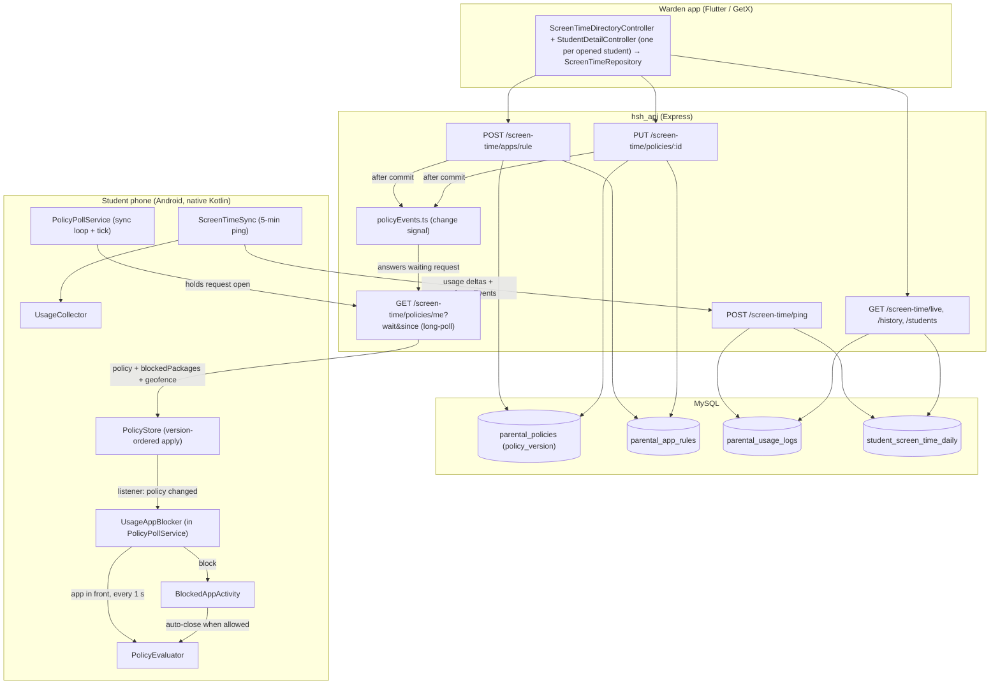

# Parental Control & Screen Time

> **Last updated:** 2026-11-27 · **Repos:** `hsh_app2` (Flutter + native Android) and `hsh_api` (Node/Express/MySQL)
>
> Paths starting with `lib/` or `android/` are in this repo; paths starting with `hsh_api/` are in the backend repo. Location tracking and curfew breaches are documented separately in [GEOFENCING_DOCS.md](GEOFENCING_DOCS.md).

---

## 1. What this feature does

Wardens (the operator console / platform admins) control and monitor each student's Android phone:

| Rule / feature | Behaviour on the student's phone |
| :--- | :--- |
| **Remote lock** | Every app except calls, keyboards, the launcher, Settings and this app is blocked until the warden unlocks. |
| **Blocked apps** | Individual apps (e.g. Instagram) are blocked. Takes effect immediately, **even if the app is already open**. |
| **App time limit** | Individual apps are blocked once today's usage reaches the app's configured limit. 0 = no limit. |
| **Bedtime** | Apps are blocked inside a nightly window (e.g. 23:00–05:00). Off when no bedtime is set. |
| **Daily limit** | Apps are blocked once today's total screen time reaches the limit. 0 = no limit. |
| **Usage dashboard** | Today's total, per-app breakdown, 30-day history, online / screen-on / current app. |

All rules are enforced **on the phone**, so they keep working offline and with the app closed. They are enforced from Android usage events by `UsageAppBlocker` (5.4). The app has **no Accessibility service** (removed 2026-11-22, see 5.6). Policy changes reach the phone **within about a second while its screen is on** (see section 4).

The curfew geofence **does not lock phones**; remote lock is the only lock wardens have.

---

## 2. Architecture

**Warden app structure (Screen Time):** `ScreenTimeRepository` makes every `/screen-time/*` call. `ScreenTimeDirectoryController` owns the student list (paging, search, summary counts), the hostel-wide night curfew and the pending app requests. Opening a student creates a `StudentDetailController` for that student only, registered under the student's id as its Get tag and deleted when the details are closed, so no state carries over to the next student. The details widgets receive that controller from the page; shared read-only helpers are top-level functions in `screen_time_utils.dart`. **Screens:** the student list; one student's *overview* (`StudentOverviewBody`: live status, today against the allowance, controls, top apps, pending requests, and links to the sections below); and a screen per section, each opened from the overview and closed with Back: *Usage & trends* (`StudentUsageScreen`: a 7 / 14 / 30 day range; the selected day against the period average with a limit ring; a stacked daily bar chart (daytime, night, over-limit, dashed limit line; tap a bar to pick the day); plain-language insights; a donut of time by app category; weekday averages with a day/night split; top apps. The numbers come from `UsageAnalytics`; resets to today when closed), *Apps* (`StudentAppsScreen`: time per app, block / limit), *Requests & history* (`StudentHistoryScreen`: pending app requests and a month calendar; each date shows that day's total, tinted by how heavy it was and red over the daily limit, and tapping one shows the day's total, night time and top apps; resets to today when closed), *Daily limit & bedtime* (`CurfewLimitScreen`) and *Restrict apps* (`RestrictAppsScreen`). A single app's time limit is still a small bottom sheet (`AppLimitSheet`). The sub-screens share `ScreenTimePage` and the navy `ScreenTimeSubHeader`.



---

## 3. File map

### Flutter (`lib/`)

| File | Role |
| :--- | :--- |
| [screen_time_policy.dart](../lib/features/screentime/models/screen_time_policy.dart) | Policy model (`isLocked`, `blockedPackages`, `dailyLimitMinutes`, `bedtimeStart`, `bedtimeEnd`, `version`). `tryParse()` accepts snake_case and camelCase; an explicit `null` bedtime means "off"; `23:00:00` is shown as `23:00`. |
| [screen_time_service.dart](../lib/core/services/screen_time_service.dart) | `hsh/screen_time` MethodChannel: permissions (incl. "Display over other apps"; `appBlockerReady`), start/stop monitoring, `syncNow`, `refreshPolicy`, `getPolicy`, `getCompliance`. |
| [screen_time_directory_controller.dart](../lib/features/screentime/controllers/screen_time_directory_controller.dart) | Warden dashboard: student directory (paging, search, counts), hostel night curfew, pending app requests. |
| [student_detail_controller.dart](../lib/features/screentime/controllers/student_detail_controller.dart) | One opened student: live status, usage, history, policy and app-rule actions. |
| [student_screen_time_screen.dart](../lib/features/screentime/views/student_screen_time_screen.dart) | Warden dashboard UI. Route `Routes.studentScreenTime`. |
| [parental_controls_card.dart](../lib/features/screentime/widgets/parental_controls_card.dart) | Lock/unlock plus one tile into each settings screen (bedtime & daily limit; blocked apps); shows "Off" when neither is set. |
| [restrict_apps_screen.dart](../lib/features/screentime/views/restrict_apps_screen.dart), [curfew_limit_screen.dart](../lib/features/screentime/views/curfew_limit_screen.dart) | Block an app; set bedtime and daily limit (each its own screen). |
| [device_setup_screen.dart](../lib/features/screentime/views/device_setup_screen.dart) | Student onboarding: Usage access, App blocker ("Display over other apps"), Location "all the time", Battery exemption, Protect from removal (device admin). The list shows only numbered steps, with no step name or description; tapping an unfinished one opens its system settings page directly. There is no skip: back (and the system back gesture) is a no-op until the four required steps (battery is optional, 5.5) are all done — a bypass here previously let a student keep using the app with device admin never active, so Force stop/Uninstall were never actually disabled (2026-11-27). |
| [home_controller.dart](../lib/features/home/controllers/home_controller.dart) | On student login/resume: sends the student to setup if a required permission is missing, then calls `syncNow()` and `refreshPolicy()`. |
| [session_store.dart](../lib/core/storage/session_store.dart) | Starts monitoring for student/leader sessions; stops it on logout. |

### Native Android (`android/app/src/main/kotlin/com/example/hsh_app2/screentime/`)

| File | Role |
| :--- | :--- |
| [PolicyPollService.kt](../android/app/src/main/kotlin/com/example/hsh_app2/screentime/PolicyPollService.kt) | Foreground service. **Sync loop:** long-polls the policy (section 4). **Tick** (30 s screen on / 60 s off): geofence work and a re-check of the app on screen for time-based rules. |
| [ScreenTimeSync.kt](../android/app/src/main/kotlin/com/example/hsh_app2/screentime/ScreenTimeSync.kt) | Usage delta ping every 5 minutes (WorkManager tick + 15-min watchdog); `fetchAndSavePolicy()`, the single native policy fetch. |
| [PolicyStore.kt](../android/app/src/main/kotlin/com/example/hsh_app2/screentime/PolicyStore.kt) | Encrypted storage of the session token, policy and backend `policy_version`. `applyPolicyJson()` discards responses older than the applied version and notifies listeners on change. |
| [UsageAppBlocker.kt](../android/app/src/main/kotlin/com/example/hsh_app2/screentime/UsageAppBlocker.kt) | The app blocker: reads the app in front from usage events every second (screen on), opens the block screen over a restricted app, and re-checks the app on screen whenever the policy changes (5.4). Runs inside `PolicyPollService`. |
| [ForegroundTracking.kt](../android/app/src/main/kotlin/com/example/hsh_app2/screentime/ForegroundTracking.kt) | Pure helpers for it: `ForegroundReplay` (app in front from usage events) and `BlockScreenThrottle` (show and log once per visit, retry every 2 s). |
| [PolicyEvaluator.kt](../android/app/src/main/kotlin/com/example/hsh_app2/screentime/PolicyEvaluator.kt) | The rule engine (`BlockReason`: device locked, app blocked, bedtime, daily limit) and the always-allowed packages. |
| [BlockedAppActivity.kt](../android/app/src/main/kotlin/com/example/hsh_app2/screentime/BlockedAppActivity.kt) | Full-screen block screen; closes itself as soon as the app is allowed again. |
| [UsageCollector.kt](../android/app/src/main/kotlin/com/example/hsh_app2/screentime/UsageCollector.kt) | Per-app foreground time from usage events; current foreground package. |
| [ScreenTimeWorker.kt](../android/app/src/main/kotlin/com/example/hsh_app2/screentime/ScreenTimeWorker.kt) | WorkManager job: runs the ping and restarts `PolicyPollService` if the OS killed it. |
| [KeepAliveReceiver.kt](../android/app/src/main/kotlin/com/example/hsh_app2/screentime/KeepAliveReceiver.kt) | Alarm that restarts `PolicyPollService` about 5–10 s after the process is killed by Stop in the Active apps panel (screen on), or about 75 s after a kill with the screen off. The service keeps pushing it back (5.5). |
| [HshDeviceAdmin.kt](../android/app/src/main/kotlin/com/example/hsh_app2/screentime/HshDeviceAdmin.kt) | Device admin with no policies. While active, Android disables Force stop. Settings can offer a separate device-admin uninstall flow (5.7). Removed on logout. |
| [KeepAliveActivity.kt](../android/app/src/main/kotlin/com/example/hsh_app2/screentime/KeepAliveActivity.kt) | Invisible screen that starts `PolicyPollService` from the foreground when a background start is refused, then closes (5.5). |
| [BootPolicyReceiver.kt](../android/app/src/main/kotlin/com/example/hsh_app2/screentime/BootPolicyReceiver.kt) | Restarts sync and the poll service after reboot or app update. |

### Backend (`hsh_api/src/`)

| File | Role |
| :--- | :--- |
| `modules/screentime/screentime.routes.ts` | All `/screen-time/*` endpoints, access rules, long-poll, transactional writes. |
| `services/policyEvents.ts` | In-process signal: `notifyPolicyChanged(studentId)` after a commit answers that student's waiting long-poll. |
| `modules/geofence/geofence.service.ts` | `findStudentId()` (numeric `students.id` **only**; bank codes / `student_code` are never matched) and the geofence payload included in `/policies/me`. |
| `config/db.ts` | Startup migrations for the parental tables. |

---

## 4. How a policy change reaches the phone

1. **Warden action.**
   - Blocking/unblocking one app → `POST /screen-time/apps/rule`.
   - Lock/unlock → `PUT /policies/:id` with `{is_locked}` only.
   - Play Store block/allow → `PUT` with `{restrict_app_installs}` only (blocking during an install pass also sends `install_pass_until: 0`).
   - 15-min install pass / revoke → `PUT` with `{install_pass_until}` only (epoch ms, `0` = none).
   - Bedtime and limit → `PUT` with just those fields.
2. **Backend commit.** `policy_version` is bumped in the **same transaction** as the change (the bump comes first and row-locks the policy, so concurrent edits get strictly ordered versions). After the commit `notifyPolicyChanged(studentId)` fires.
3. **Delivery.** With the screen on, the phone keeps `GET /screen-time/policies/me?wait=25&since=<version>` open:
   - if the stored version is already newer than `since`, the server answers at once;
   - otherwise it holds the request until the signal fires (answers in about a round-trip) or 25 s pass, then returns the current policy;
   - the response carries `longPoll: true`, and the phone immediately opens the next request.
4. **Apply.** `PolicyStore.applyPolicyJson()` ignores a response whose `policy_version` is older than the one already applied (concurrent fetches can land out of order). A lower version is accepted again after 2 minutes, covering a genuine server-side reset.
5. **Enforce.** On a real change, listeners fire. `UsageAppBlocker` re-checks the app currently on screen; if it is now blocked, the block screen appears over it. If an app is unblocked, an open block screen closes.

**Other cadences:**

| Situation | Behaviour |
| :--- | :--- |
| Screen off | Plain fetch every 120 s; the screen-on broadcast wakes the loop and triggers an immediate fetch and re-check. |
| Offline / server error | Retry with backoff 5 s → 60 s. The last good policy keeps being enforced. |
| Network restored / background data enabled | ConnectivityManager callback wakes the sync loop immediately, resets backoff, and ensures sync ticks are scheduled. |
| Server without long-poll support | Plain fetch every 30 s (detected by the missing `longPoll` flag). |
| Student opens the app | `ScreenTimeService.refreshPolicy()` wakes the loop for an immediate fetch. |
| Every ping (5 min) | The response echoes the policy (same consistent snapshot); stale echoes are discarded by the version check. |

**Single writer:** only the native side writes the enforced policy. Flutter no longer pushes policies to native (`syncPolicyToNative` was removed), which eliminated an unversioned overwrite race.

**Consistent reads:** `GET /policies/me` and the ping echo read the policy and app rules in one `REPEATABLE READ` snapshot, so a version always matches the rules returned with it. A student without a policy row is version 0.

---

## 5. Enforcement on the phone

### 5.1 Rule order (`PolicyEvaluator.evaluate`)

1. This app itself and protected packages → always allowed.
2. `isLocked` → `DEVICE_LOCKED`.
2a. `restrictAppInstalls` and the package is an app store or installer (`PolicyEvaluator.INSTALLER_PACKAGES`: Play Store, Galaxy Store, Mi/Oppo/Vivo/Huawei stores, package installers) → `INSTALLER_BLOCKED`, unless an install pass is running (`installPassUntil` in the future). `restrictAppInstalls` defaults to **false** on the phone when the backend has never sent it, so the Play Store is available by default until a warden blocks it.
3. Package in `blockedPackages` → `APP_BLOCKED`.
4. Package has its own daily limit and that app's minutes today ≥ the limit → `APP_LIMIT` ("App Time Over"; opens again tomorrow). The limits are the `daily_limit_minutes` of the app rules in `GET /policies/me` (`data.apps`), kept in `DevicePolicy.appLimits` (only limits above 0; `AppLimits.fromRules`). The ping echo carries no `apps`, so it leaves the stored limits alone. Per-app minutes come from the same `UsageCollector` snapshot as the daily total (cached 60 s), and the service's tick re-checks the app on screen, so a limit reached mid-use blocks the app within a minute or two. `clearStudentState()` (logout) clears the limits.
5. Inside **any curfew** → `BEDTIME` (see 5.8). Automatic network time turned off counts as inside (fail closed).
6. Daily limit set and today's minutes ≥ limit → `DAILY_LIMIT`.

**Protected packages (never blocked):** dialers, in-call UI, emergency, system UI, Settings (incl. Samsung), permission controller, package installer, Google Play services, plus every enabled keyboard, home launcher and dialer discovered at runtime.

### 5.2 When the check runs

| Trigger | What is checked |
| :--- | :--- |
| Every second while the screen is on | The app in front (from usage events) |
| Policy changed (listener) | The app on screen, at once |
| Every poll tick (30 s screen on) | The app on screen; also restarts the 1-second loop if it stopped |
| Screen turns on | The app on screen |

"App on screen" is the last app Android's usage events report as resumed (`ForegroundReplay`). Dialogs, keyboards and the notification shade don't produce such events. When the events don't say which app is in front, nothing is blocked (fail open).

### 5.3 Block screen

`BlockedAppActivity` shows the app icon, reason and package. "Return to Home Screen" and Back go to the launcher; "Open HSH Seva" opens this app. It closes itself when the policy changes to allow the app, re-checking every 3 s while visible.

### 5.4 App blocker (`UsageAppBlocker`)

- **How:** while the screen is on, once a second it reads the usage events since the last read (re-reading the last 5 s, since Android records them asynchronously) and replays them with `ForegroundReplay` to find the app in front. That app goes through `PolicyEvaluator.evaluate` (5.1), and a restricted app gets `BlockedAppActivity` plus a block event. `BlockScreenThrottle` logs one event per visit and opens the block screen again every 2 s while the app stays in front. It stops with the screen off, without a session, or when a permission is missing, and starts again on the next trigger in 5.2.
- **Needs:** Usage access (setup step 1) and, on Android 10+, **Display over other apps** (`SYSTEM_ALERT_WINDOW`, setup step 2). Without that permission Android does not let a background app open an activity, so the block screen cannot appear. Below Android 10 no permission is needed.
- **Setup:** step 2 (App blocker) opens Display over other apps and is done once it is on. `HomeController` sends a student back to setup while it is off.
- **Reported:** the ping's `compliance` carries `overlayPermission`, `appBlocker` (`usage_events` / `off`) and `appBlockerActive`. The warden's "App blocker disabled" warning uses `isAppBlockerOff` (`appBlockerActive == false`, or `accessibilityEnabled == false` from builds older than 2026-11-22).
- **Speed:** a restricted app is covered within about a second of opening.

### 5.5 Restart after Stop (Active apps panel)

On Android 13+ the notification shade has an "N apps are active" button. It opens a list of apps running a foreground service, each with a **Stop** button ("Active apps" on Pixel, "Enabled apps" on OnePlus/Oppo). Because `PolicyPollService` is a foreground service, this app is always listed. Stop kills the whole app (poller, blocker, location pings). Android shows that button for every ordinary app (only system, Device Owner/Profile Owner, persistent and default-dialer apps are spared), and without an Accessibility service the app cannot close the panel. So the app restarts itself instead:

- Stop keeps the app's alarms and jobs, unlike Force stop. `KeepAliveReceiver` is an inexact alarm that `PolicyPollService` keeps pushing back, so it fires only once the process is gone. With the screen on (the only time Stop can be tapped) it is a non-wakeup alarm 5 s out, re-armed every 2 s, and fires about 5–9 s after the kill; 5 s is about the shortest delay Android allows an alarm. With the screen off it is a wakeup alarm 75 s out, re-armed on every tick.
- It restarts the poller, which brings back the blocker and curfew location. If Android refuses to start the service from the background (no battery exemption, or Android 15+), `KeepAliveReceiver.restartMonitoring` opens the invisible `KeepAliveActivity` instead. "Display over other apps" allows that launch; the activity starts the service from the foreground and closes. `ScreenTimeWorker` (WorkManager) is the slower backup and uses the same fallback.
- Setup's battery step (step 4) can't be skipped by hand; it is skipped only on phones that have no such setting.
- Logout cancels the alarm (`ScreenTimeSync.stop`).
- Not covered: a truly instant restart (Stop kills every process of the app, so nothing is left to react), and phones whose Stop behaves like Force stop (alarms cleared, some OEM ROMs), which stay off until the app is opened again. Force stop from App info and uninstalling are not guarded at all (5.6).

### 5.6 No Accessibility service (removed 2026-11-22)

Google Play rejected the app (2026-11) for using the AccessibilityService API (listing description and prominent disclosure), and its policy asks apps to use narrower APIs where they suffice. Some UPI and bank apps also refuse to pay while a third-party accessibility service is on. Since `UsageAppBlocker` enforces every rule from usage events, the Accessibility service was removed:

- Removed: `AppBlockerAccessibilityService`, `SelfProtection`, `accessibility_service_config.xml`, the accessibility strings, the `com.android.systemui` `<queries>` entry, the Accessibility disclosure dialog, and the `hasAccessibilityPermission` / `openAccessibilitySettings` / `allowAppSettings` channel methods.
- Kept: every rule (lock, blocked apps, installers, app limits, bedtime, daily limit), the block screen, block events, usage, curfew and location.
- Replaced: the App info page guard by device-admin removal protection (5.7) and the Active apps panel guard by the restart in 5.5.
- Lost: blocking takes up to about a second instead of happening at once, and a student can still turn the device admin off in Settings (5.7).
- Students who already had Accessibility on must now grant Display over other apps: setup asks them on their next app open, and nothing is blocked until they do.
- Play Console: remove the Accessibility API declaration (App content) and any Accessibility text and video from the listing.

### 5.7 Removal protection (`HshDeviceAdmin`)

While HSH is an active **device admin**, Android disables **Force stop** for it and still lets users open **App info**. Android Settings can offer an **Uninstall** action that opens `DeviceAdminAdd` in uninstall mode. That flow can remove the admin and uninstall the app without calling the separate `onDisableRequested` warning. On that path, HSH relies on the polling guard below, which can miss a quick confirmation. [Android App info uninstall handling](https://android.googlesource.com/platform/packages/apps/Settings/+/fcdcf5a0a11196df094f2297e4be5ad9c0fc53fb/src/com/android/settings/applications/appinfo/AppButtonsPreferenceController.java#214), [Android device admin uninstall handling](https://android.googlesource.com/platform/packages/apps/Settings/+/refs/heads/master/src/com/android/settings/applications/specialaccess/deviceadmin/DeviceAdminAdd.java#411).

- `res/xml/hsh_device_admin.xml` asks for **no admin policies**: the app cannot lock, wipe, or change passwords through it.
- Setup step 5 (Protect from removal) opens the system "Activate device admin app?" screen with an explanation (`requestDeviceAdmin`). It is required: `HomeController` sends the student back to setup while it is off, and (since 2026-11-27) the setup screen itself can no longer be skipped or backed out of before it's done — closing a gap where a student could leave setup early, never activate the admin, and uninstall the app with no confirmation at all.
- Turning it off shows Android's confirmation with our warning (`onDisableRequested`) and triggers an immediate ping, so `compliance.deviceAdminActive: false` is sent. The student's **Monitoring** section shows "Removal protection: Off", and the install pill shows Uninstalled / Protection off (section 7).
- Logout and alumni (`ScreenTimeSync.stop`) remove the admin, so the phone can uninstall the app normally.
- **HSH tries to interrupt removal while a student is signed in** in two ways:
  - `HshDeviceAdmin.onDisableRequested`: Android calls it when the student taps "Deactivate", before the final confirmation. The app opens the block screen (`BlockReason.ADMIN_PROTECTED`, "Setting Protected") over that dialog, and the block screen then goes home.
  - `UsageAppBlocker` covers Settings' device admin screen (`DeviceAdminAdd`, matched by `ProtectedScreens.isDeviceAdminScreen` from the activity class in usage events) whenever it comes to the front while the admin is active. It looks 4 times a second while Settings is in front. The same screen is used to *activate* the admin in setup, so it is left alone while the admin is off. The device admin **list** and every other Settings screen are left alone. Side effect: while HSH's admin is on, other apps can't be activated as device admins either.
- **Reported:** each attempt records a block event (`reason: "admin_protected"`, `packageName` of Settings, `at`) and sends a ping at once instead of waiting 5 minutes.
- **A server that can't store block events never makes the phone look offline:** if a ping carrying `blockEvents` gets a 5xx, `ScreenTimeSync` sends it again at once without them (usage, compliance and geofence events still go). The block events stay queued for the next ping.
- The guard can miss fast taps, delayed usage events, and Settings variants that report a different activity. Safe mode, ADB, and a factory reset are outside its scope. Once the app is uninstalled, it stops pinging.
- Usage events identify the Settings activity. The target app is passed separately in the Settings intent or fragment arguments, so matching the activity alone would block App info for other apps too. On fully managed hostel-owned phones, the device owner can apply `DevicePolicyManager.setUninstallBlocked` to HSH's package. For dedicated devices that must also keep Settings inaccessible, Android Enterprise lock task mode can limit access to allowlisted apps. [Android usage events](https://developer.android.com/reference/android/app/usage/UsageEvents.Event), [Android App info arguments](https://android.googlesource.com/platform/packages/apps/Settings/+/main/src/com/android/settings/applications/AppInfoBase.java), [Android uninstall policy](https://developer.android.com/reference/android/app/admin/DevicePolicyManager#setUninstallBlocked(android.content.ComponentName,%20java.lang.String,%20boolean)), [Android lock task mode](https://developer.android.com/work/dpc/dedicated-devices/lock-task-mode).

**Push notifications are live on the app side (2026-11-28): Firebase/FCM, switched off since the "FIREBASE DISABLED" rollback, is re-enabled** — `PushNotificationService` initializes Firebase, requests permission, registers the device's FCM token with the backend (`POST /auth/fcm-token`, already implemented), and a received push routes a tap straight to the student's Screen Time page when its `data.type` is `admin_protected`, `admin_disabled`, `suspected_uninstall` or `code_redeemed` (same handling as any other Screen Time push). `hsh_api` sends its Screen Time alerts as `type: "screen_time_alert"` (with `alert_type`) and app requests as `type: "app_request"`, both with `route: "/student-screen-time"`; that server name is not an app route, so the app treats it as a Screen Time push (supervisors open the student's page, anyone else goes home). Two things are still needed before a warden's phone actually buzzes:

- **`android/app/google-services.json`**: not checked in (per `AGENTS.md`, no new credentials are committed). Download it from the Firebase console for this app's package name and drop it in locally — the Gradle plugin (`android/app/build.gradle.kts`) only applies when that file exists, so its absence is harmless, it just means no FCM token.
- **`hsh_api` must actually send the push**, not only create the in-app alert row:

1. `POST /screen-time/ping`: store `blockEvents` (today they are ignored), at least those with `reason: "admin_protected"`: student id from the token, `packageName`, `appName`, `reason`, `at` (epoch ms).
2. On an `admin_protected` event, or when `compliance.deviceAdminActive` changes to `false`, send an **FCM push** (not just a Screen Time alert row) to the student's wardens'/leaders' registered tokens, with `data: {"type": "admin_protected", "student_id": "...", ...}` (`type: "admin_disabled"` when it actually turns off) — that `type` is what the app's tap-routing switches on. Also show it in the Screen Time alerts list as today.
3. Uninstall can only be inferred: alert when a student with an active session sends no ping for a set time (for example 30 minutes with no ping after the last one had `deviceAdminActive: false`) — push `type: "suspected_uninstall"`.
4. On a redeemed removal code (§5.7a), push `type: "code_redeemed"` the same way.
5. Keep returning the latest `compliance` on `GET /screen-time/students` and `/live` (already done today): the student's Monitoring section and the install pill read it.

### 5.7a Removal codes (break-glass uninstall, 2026-11-27)

A warden-issued one-time 6-digit code lets a student turn off removal protection themselves — for a genuine uninstall or phone handover — without a warden needing to be physically at the phone and without weakening the block in 5.7 otherwise. Warden side: `ParentalControlsCard.generateRemovalCode` (hidden for leaders, the server answers 403). Student side: the code field on `BlockedAppActivity`'s `ADMIN_PROTECTED` screen and `RemovalCodeVerifier`.

1. `POST /screen-time/removal-codes` (**warden / admin only**), body `{"student_id": "<numeric students.id>"}` → `{"success": true, "data": {"code": "483920", "expiresAt": "…Z"}}`. Valid 10 minutes and 5 tries; a new code cancels the previous one.
2. `POST /screen-time/removal-codes/verify` (the student's own bearer token), body `{"code": "483920", "purpose": "removal" | "setup"}` (`purpose` optional; the app does not send it yet, so the audit log records `device`) → `{"valid": true}` or `{"valid": false}`. Any other shape or a non-2xx status is `false` (`RemovalCodeVerifier` never treats an error as a pass).
3. The server logs who issued each code and when and for what it was redeemed, and raises a `code_redeemed` Screen Time alert ("Warden code used").

**The same code also gates the other three required steps** (usage access, app rules, location — not the optional battery step), from the Flutter side rather than native Kotlin, since those don't have a device-admin-style OS confirmation screen to cover. `SessionStore.requiredSetupEverCompleted` remembers (per install, cleared on logout) once all four required steps have ever been granted at once; after that, `device_setup_screen.dart` treats any one of them turning back off as a regression — not a first-time setup — and locks the step list behind the same 6-digit code (verified via `ScreenTimeRepository.verifyRemovalCode`, the same `POST /screen-time/removal-codes/verify` above) before the student can redo it. A brand-new student who has never finished setup is unaffected; this only engages after a regression.

### 5.7b Login gate from the second login onward (2026-11-27)

By policy, a student's/leader's **first ever login is free; every login after that needs a warden-issued code** — this is deliberately broader than "only after a detected reinstall": it also covers a student simply logging out and back in, an expired/cleared local session, or a new phone, not just evasion attempts. Resuming an already-stored session (the common case — the app reopening with a valid cached token, handled in `SplashController`, never touching `/auth/login`) is **not** a login and is never gated; this only applies when credentials are submitted fresh, i.e. `POST /auth/login` (and `/auth/auto-login`) for `student`/`leader` roles. Admin, warden and staff accounts must never be gated by this — practically all of them need to already be able to log in to issue a code in the first place.

`LoginRequest` carries an optional `code`; `LoginController.login()` sends it once the server has asked for one. Every `POST /auth/login` from this app also carries `"client": "hsh_app2_mobile"`.

1. A student's / leader's later login without a right code gets HTTP `428` `{"requires_code": true, "message": "…"}` and no token.
2. The code is the one from §5.7a. A correct code completes the login and is used up.
3. Alumni, staff and viewer logins are not gated. Admin and operator logins use their own code (§5.7c). This gate applies only when the server sets `LOGIN_CODE_GATE=on`; it is off otherwise.
4. **Must not reach the attendance web portal.** Students currently log in on a separate web portal to mark attendance, and that must keep working exactly as it does today — this gate exists to slow down a phone that's being re-set-up after someone turned monitoring off, not to block a student from a browser. The server must key the gate on the `client: "hsh_app2_mobile"` field above, not on role alone: a `student`/`leader` login with no `client` field, or a different one, is the web portal (or another caller) and must never be asked for a code, regardless of `LOGIN_CODE_GATE`.

### 5.7c Admin login code on WhatsApp (2026-11-27)

Admin access is granted **only** by a 6-digit code the server sends on WhatsApp to both **7984907753** and **9712977261**. Typing any number in `AppConfig.allowedAdminPhoneNumbers` and tapping Sign In sends `username: "admin"`; the server answers `428` and the form shows **Admin code** with **Send a new code**. The code is valid 5 minutes and 5 tries; at most one a minute and five an hour.

- The app must never create an admin session by itself. A SIM with an administrator number only fills in the field (no auto-login), and a failed request leaves the user signed out.
- A student whose phone number is an administrator's is just a student.
- Admin and operator tokens issued before this change are refused (`401`), which signs the app out. At startup `SplashController` opens the console only for a saved token carrying `otp: true`.
- After a code login the phone stays signed in until Sign out or until the token expires (`JWT_EXPIRES_IN`); reopening the app asks for no new code.
- If WhatsApp cannot send: on the server, `node dist/scripts/adminCode.js` prints a code.
- Only a platform admin can link or unlink the shared WhatsApp number the codes come from.


---

### 5.8 Curfew sessions (`CurfewSchedule`)

Wardens group students into named **curfew sessions** (e.g. "Night Curfew" 22:00–06:00 every day, "Afternoon Study" 14:00–16:00 Mon–Fri). Every policy response (`GET /policies/me`, the long-poll and the `POST /ping` echo) carries `policy.curfew_sessions`: only the sessions that are on and not paused for this student, plus the personal bedtime (`source: "personal"`). The server filters; the phone just enforces the list.

On the Screen Time page, wardens and admins see these sessions in the **Night Curfew** card (`NightCurfewCard`): every curfew with its times, days, state and its own on/off switch, plus **Add curfew** (times, then students, the same flow as the Curfew sessions screen: `createCurfewSession`, `toggleCurfewSession`). Tapping one opens its details. The card's last line is the **campus geofence** window ("Campus geofence (location alerts)"), which only reports leaving the campus and never locks phones. Leaders keep only the geofence line.

- `PolicyStore.applyPolicyJson` stores the list in `DevicePolicy.curfews`. A payload without the key keeps the stored list; an empty list means no curfew. `clearStudentState()` (logout) clears it.
- `DevicePolicy.effectiveCurfews` is that list, or, while the server has never sent it (older backend), the single legacy `bedtime_start/end` every day.
- `CurfewSchedule` (same maths as the backend and `lib/features/screentime/curfew/curfew_schedule.dart`): times are **IST** whatever the phone's time zone; a window that ends before it starts crosses midnight and belongs to the day it **starts** (Monday-only 22:00–06:00 runs Mon 22:00 → Tue 06:00); the phone blocks while **any** window runs.
- No alarm is needed for start and end: `UsageAppBlocker` re-evaluates the app on screen every second.
- `nightScreenTimeMinutes` in the ping is now **screen time inside any curfew** (the dashboards' "session use"): `ScreenTimeSync` reads usage for each curfew run of the day (`CurfewSchedule.curfewIntervals`, overlaps merged) and sends only the new whole minutes, like the app minutes (the server adds them up).

## 6. Usage telemetry

- `UsageCollector` rebuilds per-app foreground time from raw usage events (RESUMED/PAUSED pairs, closed by screen-off, keyguard or shutdown), clamped to local midnight.
- `ScreenTimeSync` sends **only new whole minutes** per app (leftover seconds carry over), so the backend can add deltas without double-counting. After midnight it first flushes the tail of the previous day.
- **The "already reported" baseline is lined up with the server before it is trusted.** It lives on the phone, so a reinstall or cleared app data loses it, and a new login may be another student. Without a check, the phone re-sent the whole day and the server added it again (2h 12m became 4h 24m). Now every login (`ScreenTimeSync.start`, which also runs at each app launch), every logout (`clearStudentState`) and every new day leaves the baseline unconfirmed (`PolicyStore.sentConfirmedDate`). Before the next report, the phone reads `GET /screen-time/live` (its own today: `date`, `appUsageBreakdown[].minutes`, `nightScreenTimeMinutes`) and uses those numbers as the baseline (`UsageBaseline`). Only minutes beyond what the server already counts are sent. If that read fails, nothing is sent until the next tick. When the server's day (IST) differs from the phone's, the phone keeps its own baseline. The previous day's tail is flushed only when that day's baseline was confirmed for this login.
- Each ping writes everything in **one transaction**. The phone only advances its "already reported" counters and drops its geofence-event queue after a 2xx, so a failed or retried ping never double-counts or loses data.
- "Online" on the dashboard means a ping within the last 10 minutes.

---

## 7. Warden dashboard

**Monitoring** (student's Screen Time page, `_StatusStrip` in `live_status_card.dart`, `monitoringChecks` in `screen_time_utils.dart`): every permission HSH needs, On or Off, from the phone's last `compliance`: Usage access, App blocker (Display over other apps; Accessibility on old builds), Location "Allow all the time", GPS, Keep running in background (battery exemption) and Removal protection. Under the live status, one compact row holds the install pill and a Monitoring chip ("Monitoring: all on" / "Monitoring: 2 off"). The list starts collapsed; tapping the chip opens it, and each Off row says what stops working. A permission the phone didn't report (older builds) is left out. The student **list** shows no monitoring status.

**HSH app installed or not** (`appInstallStatus` in `screen_time_utils.dart`, `AppInstallStatusPill`): shown on every student row (compact) and on the student's live status card. A removed app sends nothing, so it is a guess from the device admin (removal protection) in the latest `compliance` (HAMS_WEB `GET /screen-time/students`):

| Status | When |
| :--- | :--- |
| Installed | `deviceAdminActive: true` (granted in setup step 5), or an older build without the key that has reported |
| Protection off | `deviceAdminActive: false`, but the phone is online, so the app is clearly still there |
| Uninstalled | `deviceAdminActive: false` and the phone is not online: taken as uninstalled, since turning the admin off is the step before uninstalling |
| Not installed | Never reported (no `compliance`): not installed, or the student never finished setup |

Operator home → **Screen Time** (leaders: Services → Leader Tools, or the profile hub). Allowed app roles: `canViewScreenTime` (admin, warden, leader); allowed backend roles: operator, platform-admin, leader, wing-leader.

**Students are identified only by their numeric `students.id`** (the `id` of a directory entry). Every request for the selected student uses it; there is no fallback to bank codes or names. Another screen can open a student directly by passing `{id}` (or a numeric `studentId`) as route arguments. The phonebook has no `students.id`, so it passes `{name, room}` and the directory opens searched by that name; the warden then taps the student. The directory search box is sent to the server, so it searches every student, not just the 100 shown unfiltered.

- **Directory:** all students with today's minutes, online, screen-on, current app and locked state. Summary tiles (Total, Online, Offline, Locked, Attention) and a filter sheet (group, floor, residence status, usage and policy toggles, sort).
- **Leaders see only their own group.** `ScreenTimeDirectoryController` first asks `GET /students?limit=1` for the caller's `leaderGroupName`, then loads the whole group in one request (`?group=<name>&limit=1000`). The server's totals are then the group's. Every later list, search and refresh request carries `group`. Phonebook residents without a phone set up are merged only when their phonebook group matches, and the list filter also drops any row of another group. Pending app requests are kept only for the group's students. A student passed in by another screen or a notification (`{id}`) is held until the role is known; a leader only gets it opened when that student is in their group ("Not in Your Group" otherwise). Without a `leaderGroupName` the leader sees "Your group is not set" and no students. A fixed note under the search says which group is shown; the filter sheet has no group section for leaders.
- **Groups (admins and wardens):** a row of group chips (Param, Pavitra, Pulkit, Paramanand, Alumni). One tap narrows the list, another tap shows everyone. The picked group shows how many of its students are loaded, with "+" while more pages remain (the list loads 20 at a time). A student's group comes from the directory row or, failing that, the phonebook cache; it is a display filter only and never used to pick a student for an action.
- **Student detail:**
  - live status and usage hero (today vs limit);
  - per-app list with categories (Social Media, Entertainment, Gaming, Study & Tools, Other) and a Restrict button;
  - 30-day history (Usage & trends, and the calendar);
  - parental controls card: lock/unlock (with confirmation), curfew & daily limit sheet, restrict-app sheet, **Play Store switch** (Blocked / Allowed, with confirmation; covers every package in `INSTALLER_PACKAGES`), and, while blocked, a 15-min install pass. Blocking ends a running pass. The student sees the "Installation Blocked" screen and can send a request from it.
- Each action is applied optimistically and rolled back with an error message if the server rejects it. A policy read that was requested before such a change is not shown when it lands, so it can't put the old rules back on screen.
- **Requests while a student is open:** the live status every 2 minutes and on resume (`include_history=1` on open and pull-to-refresh). The 30-day history is fetched again only when it is older than 15 minutes. Past days are asked for one by one (`/history/:id?date=`) only for days with usage, at most once per opened student, and not at all after the server answers one without an app list (today's API keeps only daily totals for past days).

### 7.1 Overview and curfew sessions (`lib/features/screentime/curfew/`)

Two buttons at the top of the warden's Screen Time page:

- **Overview** (`ScreenTimeOverviewScreen`, every supervisor; leaders get their own group from the server): right now (using phone in curfew, in curfew, protection removed, locked), phones (online / quiet / offline / never connected), needs attention, today, last 7 days. A tile opens the students behind it (`GET /students?filter=`), and a student opens the summary (`GET /students/:id/summary`).
- **Curfew sessions** (`SessionsScreen`, wardens and admins only; hidden for leaders, the server answers 403): list with an on/off switch, create / edit (partial `PATCH`), add students (all residents, picked students from the shared `StudentPickerSource`, floors, groups, tags, with a live preview), pause one student, remove, live view and history.
- HTTP goes through the app's `ApiClient` Dio (`ScreenTimeApi`); students are numeric `students.id` only. `curfew_admin_entry.dart` wires groups, tags and the picker.
- Online status: when the server sends `connectionStatus` (`online` ≤ 10 min, `quiet` 10–60 min, `offline`), `isStudentDisconnected` follows it, so there is no gap between "online" and "disconnected".

---

## 8. API reference

Mounted at both `/api/screen-time/...` and `/screen-time/...`; all require a Bearer token. "Self" means a student reading their own data (no id, `me`, or their own id). A student identifier is always a numeric `students.id` without leading zeros; anything else (a bank code like `0768`, `HSH-…`) returns 404. Responses use `{ success, message?, data? }`.

| Method & path | Who | Notes |
| :--- | :--- | :--- |
| `POST /ping` | Student's own phone (supervisor may pass `student_id`) | Body: `date`, `totalScreenTimeMinutes`, `isScreenOn`, `currentApp`, `appUsageBreakdown[]`, `geofenceEvents[]`, `deviceUuid?`. Response echoes `policy` (with `policy_version`) and `blockedPackages`. |
| `POST /inventory` | Student's own phone | `{ apps: [{packageName, appName}] }` |
| `GET /live/:id?` | Self or supervisor | Today's status, `appUsageBreakdown`, `policy`, `blockedPackages`, `lastPing`. `?include_history=1` adds the 30-day `records` (same rows as `/history`). |
| `GET /history/:id?` | Self or supervisor | Last 30 days of daily totals: `date` (`yyyy-MM-dd`), `total_screen_time_minutes`, `night_screen_time_minutes`, `current_app`, `last_ping`. `?date=` is ignored; there is no per-app breakdown for past days. |
| `GET /students?search=` | Supervisor | Directory (max 100) |
| `GET /policies/:id?` | Self or supervisor | `{ policy, apps, blockedPackages, geofence }`. Long-poll with `?wait=<s ≤ 25>&since=<version>` (self only); response has `longPoll`. |
| `PUT /policies/:id` | Supervisor | **Partial:** any of `is_locked`, `daily_limit_minutes` (0–1440), `bedtime_start`/`bedtime_end` (`HH:mm`, or `''`/`null` to clear both), `blockedPackages` (complete set), `restrict_app_installs` (boolean, Play Store blocked), `install_pass_until` (epoch ms, `0` = none). camelCase accepted. `GET /policies/:id`, `GET /policies/me` and the ping echo must return `restrict_app_installs` and `install_pass_until` inside `policy`. |
| `GET/POST /sessions`, `PATCH/DELETE /sessions/:id` | Warden/admin | Curfew sessions. `PATCH` is partial (`name`, `start_time`, `end_time`, `days`, `is_active`). |
| `POST /sessions/:id/students[/preview]`, `DELETE /sessions/:id/students`, `PATCH /sessions/:id/students/:sid` | Warden/admin | Bulk add / preview / remove by `student_ids`, `floor_ids`, `groups`, `tag_ids`, `all_active`; `{is_paused}` per student. |
| `GET /sessions/:id/live`, `GET /sessions[/:id]/history` | Warden/admin | Running now and who is using the phone; change log with the warden's name. |
| `GET /overview`, `GET /attention?type=`, `GET /students/:id/summary?range=` | Supervisor | Dashboard; leaders limited to their group. |
| `POST /apps/rule` | Supervisor | `{ student_id, package_name, app_name?, is_blocked, daily_limit_minutes? }`. One app; version bump + rule in one transaction. |

**Supervisor** = `requireRole('operator', 'leader', 'wing-leader')`: the operator console token, platform-admin staff and student leaders (`GET /students` also returns the leader's `leaderGroupName`). A student, leaders included, can never change the policy of their own phone. Students can no longer change their own policy (previously a student could unlock themselves).

---

## 9. Database (created by `hsh_api/src/config/db.ts`)

| Table | Purpose |
| :--- | :--- |
| `parental_policies` | One row per student: `policy_version`, `daily_limit_minutes`, `bedtime_start`, `bedtime_end`, `is_locked`, `restrict_app_installs` (`TINYINT(1) DEFAULT 1`), `install_pass_until` (`BIGINT DEFAULT 0`), `updated_at` |
| `parental_app_rules` | Per student and package: `app_name`, `is_blocked`, `daily_limit_minutes` |
| `parental_usage_logs` | Per student, date and package: `usage_minutes` |
| `student_screen_time_daily` | Per student and date: totals, `is_screen_on`, `current_app`, `last_ping` |
| `student_devices` | Device UUID → student (moves to the new student when a phone is re-used) |

---

## 10. MethodChannel `hsh/screen_time`

| Method | Description |
| :--- | :--- |
| `hasUsagePermission` / `openUsageSettings` | Usage access check / Settings page |
| `isBatteryOptimizationIgnored` / `requestIgnoreBatteryOptimizations` | Battery exemption |
| `startMonitoring` `{token, baseUrl}` | Saves the session natively, schedules the ping, starts `PolicyPollService` |
| `stopMonitoring` | Cancels work, clears the session, resets the policy and all per-student state |
| `syncNow` | Immediate ping → `ok` / `no_permission` / `no_session` / `unauthorized` / `error` |
| `refreshPolicy` | Wakes the native sync loop for an immediate policy fetch |
| `getPolicy` / `getBlockedPackages` / `getCompliance` | Read what the phone currently enforces / reports |
| `isDeviceAdminActive` / `requestDeviceAdmin` | Device admin check / system activation screen (5.7) |
| `hasOverlayPermission` / `openOverlaySettings` | "Display over other apps" check (always true below Android 10) / Settings page; lets `UsageAppBlocker` open the block screen (5.4) |

---

## 11. Permissions

`PACKAGE_USAGE_STATS` (granted in Settings → Usage access), `RECEIVE_BOOT_COMPLETED`, `FOREGROUND_SERVICE` + `FOREGROUND_SERVICE_SPECIAL_USE` (+ `_LOCATION`), `REQUEST_IGNORE_BATTERY_OPTIMIZATIONS`, `POST_NOTIFICATIONS`, and `SYSTEM_ALERT_WINDOW` ("Display over other apps": the block screen, 5.4, and the restart screen, 5.5; also the warden's caller ID popup). A device admin receiver `HshDeviceAdmin` (`BIND_DEVICE_ADMIN`, no policies, 5.7). No Accessibility service (5.6). `BlockedAppActivity` is `singleTask`, excluded from recents, full-screen.

---

## 12. Testing

**Backend (run 2026-10-05/06 against a local MySQL with throwaway students, via ad-hoc `tsx` scripts that are not committed):**

- a restriction reaches a waiting long-poll about 0.5 s after the warden's request starts;
- "behind" phones are answered immediately and an idle request is held until its wait expires;
- multiple apps, unblock-one-keeps-others, 13 concurrent toggles → version +13 and the last change wins, with no response pairing a version with the wrong rules;
- lock and gate pass also wake the phone; aborted connections are handled; wardens can't long-poll another student;
- access rules (students can't read others or unlock themselves); partial PUT keeps other fields; bedtime clearing;
- student ids only (2026-10-06): a bank code equal to another student's id (`0<id>`) is rejected for reads, locks and app blocks, while the numeric id targets exactly that student.

All checks passed. Native code compiles; `flutter analyze` is clean.

**On a real student phone (not yet run):**

- [ ] Student using App A → warden blocks App A → App A is closed and the block screen appears within about a second.
- [ ] Warden blocks App B while the student uses App A → opening App B is blocked immediately.
- [ ] Warden unblocks App A → the block screen closes and App A opens without a restart.
- [ ] Block several apps; toggle one repeatedly; the final state always wins.
- [ ] Remote lock and unlock apply within about a second (screen on).
- [ ] Bedtime starting while an app is open blocks it within 30 s.
- [ ] Turn on airplane mode, change rules, reconnect → the latest rules apply and nothing older overrides them.
- [ ] Reboot → monitoring resumes without opening the app.
- [ ] Calls, emergency dialer and keyboard still work while locked.
- [ ] Usage access and Display over other apps on: opening a blocked app shows the block screen within about a second; blocking the app that is open closes it; lock and unlock apply.
- [ ] Google Pay / PhonePe payments go through.
- [ ] HSH no longer appears under Settings → Accessibility.
- [ ] After setup step 5 on a signed-in spare test phone: App info opens and Force stop is disabled. If Uninstall is available from App info or the launcher, check which system confirmation opens and record whether HSH's protection screen appears before removal can be confirmed. Record the phone model and Android version for any successful removal.
- [ ] Settings → Device admin apps → HSH: the deactivate screen is covered by "Setting Protected" within about a second, and tapping "Deactivate" is covered before it can be confirmed; other Settings screens work normally.
- [ ] Each attempt arrives in the next ping right away (`blockEvents` with `admin_protected`).
- [ ] Logout → the device admin is gone and the app can be uninstalled.
- [ ] Battery optimization off: tap Stop in the Active apps panel → the monitoring notification and app blocking come back within about 10 seconds, without opening the app.

---

## 13. Known limitations

- **Telemetry the backend ignores:** HAMS_WEB stores the ping's `compliance` (latest per day, returned on `/students`), but not `blockEvents`, app icons, `deviceTime` or `currentPackage`.
- **Night minutes:** the phone never sends `nightScreenTimeMinutes`, so night minutes stay 0 and the **Night** filter shows nobody.
- **Old app builds and bank codes:** a warden phone still on a build from before 2026-10-06 sends the bank code when opening Screen Time from the phonebook. Codes with a leading zero (`0001`–`0999`) are now rejected (nothing opens). Codes `1000` and up are plain numbers, so the backend reads them as a student id and can still open the wrong student until that phone updates.
- **Single backend process for instant delivery.** The change signal is in-process. With several API processes, changes still arrive, but up to 25 s later.
- **Screen off:** changes arrive within 120 s, or immediately when the screen turns on.
- **Missed app switch:** if usage events don't say which app is in front, nothing is blocked until the next switch (it fails open rather than blocking the wrong app).
- **Old app builds** still push the policy from Flutter without a version and don't re-check the open app; the new backend still serves them correctly.
- **Android only:** iOS student phones are not monitored.
- **Leader scope is enforced by the app, not the server.** `hsh_api` returns every student to a leader unless `group` is sent, and lets a leader read or change any student's rules. The app always sends the group, but the backend should also limit leaders to `leaderGroupName` on `/students`, `/live`, `/history`, `/policies`, `/apps/*`.
- **Removal protection** (5.7) tries to interrupt deactivation and the Settings uninstall flow while signed in. Detected attempts are sent to the backend. A Stop from the Active apps panel is undone within about 10 s (5.5).
- **Blocking latency and ROMs:** up to about 1 s before a restricted app is covered, and some ROMs (e.g. MIUI's "Display pop-up windows while running in the background") need an extra permission before Android lets the block screen open from the background.

### Managed-device payment pilot (debug only)

Use a spare hostel-owned Android phone with YouTube installed and no accounts
or existing device owner at enrollment. Use the debug APK only.

```powershell
flutter build apk --debug
adb devices
adb install -t build/app/outputs/flutter-apk/app-debug.apk
adb shell dpm set-device-owner --user 0 com.avd_hsh.app/com.example.hsh_app2.pilot.ManagedDevicePilotAdmin
adb shell am start -n com.avd_hsh.app/com.example.hsh_app2.pilot.ManagedDevicePilotActivity
```

If Android rejects enrollment because an account or owner is already present,
use a clean spare phone. Enrollment changes device management state. Never
enroll a student's personal phone for this test.

1. After enrollment, set up Google Pay and confirm a small payment with
   YouTube available.
2. Open the pilot again and tap **Block YouTube**. Confirm Android refuses to
   open YouTube from the launcher. Complete a small payment in Google Pay and
   repeat for other required UPI apps.
3. Tap **Restore YouTube** and confirm that it opens again.
4. With a known screen PIN already set, tap **Lock screen now** and verify that
   Android locks and the PIN unlocks the phone.

The pilot exercises local Android enforcement. Warden policy sync, scheduled
bedtime, usage-limit expiry, and a persistent remote lock require separate
implementation and testing.

Restore YouTube before removing the test owner. Then run:

```powershell
adb shell dpm remove-active-admin --user 0 com.avd_hsh.app/com.example.hsh_app2.pilot.ManagedDevicePilotAdmin
adb uninstall com.avd_hsh.app
```

### Security Hardening & Optional Device Owner (Intake Phones)

- **Student logout gate:** Non-alumni students must verify a 6-digit warden override code (`purpose: 'logout'`) before logging out and releasing Device Admin.
- **Protected Settings:** On monitored phones with setup active, `UsageAppBlocker` covers `DeviceAdminAdd`, Usage Access, Display Over Other Apps, Date & Time Settings, and Developer Options (`SETTINGS_PROTECTED`), allowing a 3-minute temporary pass with a warden override code (`purpose: 'settings'`).
- **Tamper & offline telemetry:** `POST /screen-time/ping` detects and alerts on `permission_revoked`, `clock_tamper` (`autoTimeEnabled: false` or >2 min `deviceTime` drift), and `secondary_profile` (`multipleUsersOrProfiles: true`), and cron sweeps `prolonged_offline` (default 120 min silence while restrictions are active). `GET /screen-time/attention` (`type=tampered`) and `GET /screen-time/students?filter=tampered` expose tampered devices.
- **Browser restriction & dynamic resolution:** `restrict_browsers` on `PUT /screen-time/policies/:id` blocks standalone browsers resolved dynamically via `PackageManager` + `PolicyEvaluator.BROWSER_PACKAGES` (while keeping `ALWAYS_PROTECTED` UPI/banking apps unaffected).
- **Policy audit & setup state:** `POST /screen-time/setup-complete` persists onboarding completion on `student_devices`, and `GET /screen-time/students/:id/policy-history` returns the immutable `screen_time_policy_logs` audit trail.
- **Force update & Samsung overlay tamper protection:** `AppUpdateService` queries `GET /api/version` on startup and resume, gating builds below `min_version_code` when `force_update: true` (granting a 2-minute `grantUpdatePass()` so Play Store / Package Installer can apply the update even when `restrict_app_installs` is on). `ProtectedScreens` covers Samsung `*Overlay*` / `*AppearOnTop*` / `*UsageData*` settings activities, and `PolicyPollService` triggers an immediate `ScreenTimeSync.syncNow()` + high-priority alert notification when `UsageAppBlocker.isReady()` drops.
- **Per-install device lock & admin approval:** `DeviceIdentityService` generates a per-install UUID stored in encrypted secure storage (`android:allowBackup="false"`) and sends `device_uuid`, `device_model`, `hardware_id`, `os_version`, and `app_version` on `/auth/login` and `/auth/auto-login`. First login registers and binds the phone to `students`, `device_ip_bindings`, and `student_devices`. Reinstalling the app or logging in from a different device is blocked (`428 NEW_DEVICE_APPROVAL_REQUIRED`, raising a `new_device_login` alert) until approved either with a 6-digit warden code (`device_transfer`) or one-tap via `GET/POST /screen-time/device-requests/:id/approve|reject`.
- **Production Device Owner option:** Clean hostel-owned Android devices can be provisioned with `adb shell dpm set-device-owner --user 0 com.avd_hsh.app/com.example.hsh_app2.screentime.HshDeviceAdmin` to enforce `DISALLOW_UNINSTALL_APPS`, `DISALLOW_SAFE_BOOT`, `DISALLOW_CONFIG_DATE_TIME`, `DISALLOW_DEBUGGING_FEATURES`, `DISALLOW_ADD_USER`, and package suspension at the OS level.
